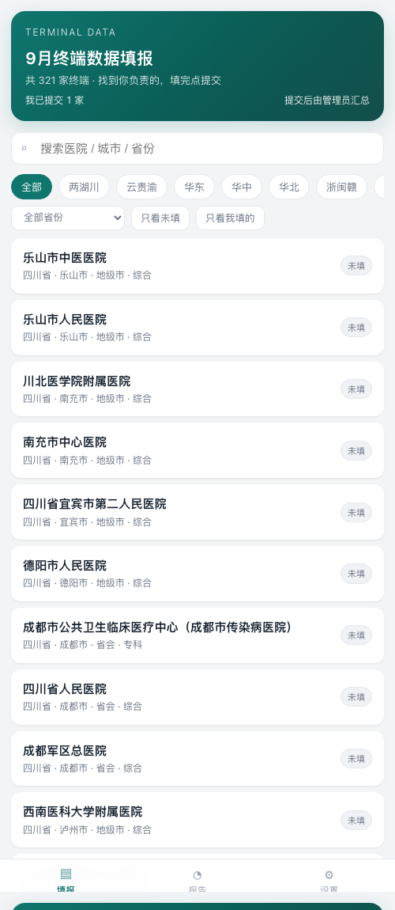
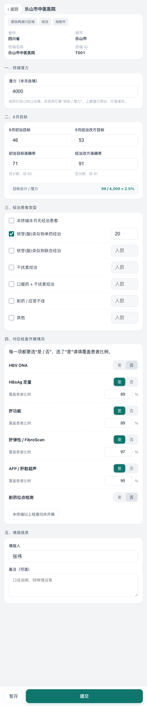
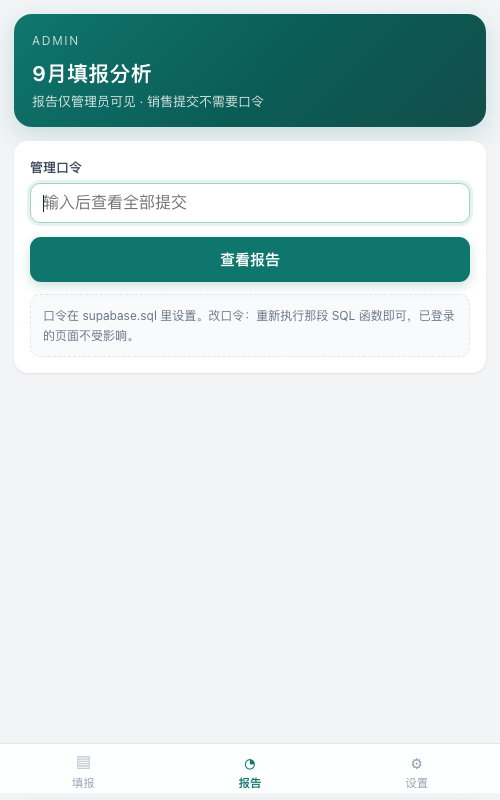
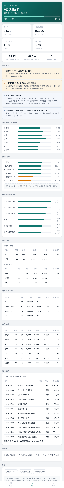
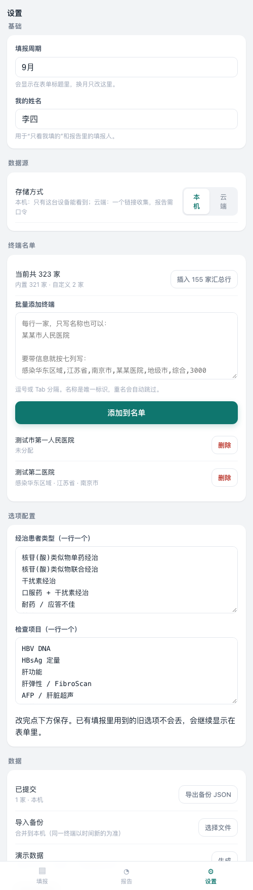

# 终端数据填报（一个链接收集，自动出报告）

一条链接发给所有销售，谁都能打开、找到自己的终端、填完提交；你凭口令进去看全部结果和自动分析。

- **销售**：不需要账号、不需要登录，打开链接就能填。提交后只能看到自己填过的，看不到别人。
- **你**：在「报告」页输入口令，看全部提交、自动结论、导出 Excel。

纯静态网页 + 一个免费数据库，不需要服务器。

## 界面预览

<p>



</p>

<p>

</p>

---

## 为什么是这个形式

| 方案 | 能不能满足「谁都能填 + 只有你能看」 | 代价 |
|---|---|---|
| **静态网页 + Supabase（本方案）** | 能。提交只写不读，报告走口令函数 | 建一次库，15 分钟 |
| 微信小程序 | 能 | 企业主体认证 + 类目审核 + 域名备案，2–4 周 |
| 企业微信自建应用 | 能 | 要企微管理员配合，且只有内部员工能用 |
| 飞书 / 腾讯文档多维表格 | 勉强 | 按人锁行要付费版；20 多个字段手机横滚难填；没有校验和自动结论 |
| 问卷星 / 表单工具 | 不能 | 每人交一条，321 家会变成一堆重复记录，还得人工合并 |

---

## 一键部署（GitHub Pages）

目标地址：**https://fdd77931-arch.github.io/terminal-collect/**

```bash
cd terminal-collect
bash deploy.sh
```

脚本会自己做完这五步：建本地仓库 → 提交 → 创建 `fdd77931-arch/terminal-collect` → 推送 → 开启 Pages。

**如果提示没装/没登录 `gh`**，脚本会打印一段手动命令，照着复制两次就行（大约 2 分钟）。也可以提前装好：

```bash
brew install gh && gh auth login
```

只想演练不推送：`bash deploy.sh --dry-run`；想换仓库名：`REPO=另一个名字 bash deploy.sh`。

> ⚠️ **仓库是 Public 的**，`terminals.js` 里 321 家医院名单和潜力值会被所有人看到（只是不容易被搜到，页面已加 `noindex`、`robots.txt`）。如果这个名单本身不能外流，就别用免费 Pages，改装到 **Cloudflare Pages** 或**阿里云 OSS 私有 bucket**——代码一个字不用改，我也可以给你出那份配置。

> 国内访问 GitHub Pages 偶尔慢。销售反馈打不开的话，把同样的文件丢到阿里云 OSS / 腾讯云 COS / 公司内网 Nginx 即可。

## 建库（Supabase，免费）

1. 注册 https://supabase.com ，新建 project（区域选新加坡）
2. **SQL Editor** → 新建查询 → 粘贴 `supabase.sql` → Run
3. **Project Settings → API**，复制 `Project URL` 和 `anon public` key

## 配置并改口令

1. 打开网页 →「设置」→ 存储方式选**云端**→ 粘贴 URL 和 anon key → 点「测试连接」
2. 打开 `supabase.sql`，把 `change-me-2026` 改成你自己的口令，**只重新执行那一段 `create or replace function report_rows`**
3. 把网页链接发群里

之后：销售打开链接直接填；你打开同一个链接，点「报告」，输口令看全部。

---

## 权限是怎么分的

| | 销售（拿到链接的人） | 你（管理员） |
|---|---|---|
| 打开填报页 | ✅ | ✅ |
| 提交 | ✅ | ✅ |
| 读别人提交的数据 | ❌ 数据库层面禁止 | ✅ 凭口令 |
| 看报告 | ❌ 要口令 | ✅ |
| 改/删数据 | ❌ 没有 update/delete 权限 | ❌ 也删不了，只能去 Supabase 后台 |

实现方式：

- `anon` key 写在网页里是**安全的**，它只有 `insert` 权限，读不到任何行。
- 报告通过 `report_rows(pass)` 这个 `security definer` 函数取数，口令不对直接报错。
- 提交是**追加**的，不覆盖：同一个人改数就再交一次，报告按「每个终端取最新一条」汇总，历史全都留着，谁什么时候改的都能查。

⚠️ 两个必须知道的点：

1. **口令是唯一的门**。别用 `change-me-2026`，别把口令写进群公告。
2. 链接本身不设限，拿到链接的人都能提交一条假数据。真出现刷数据，去 Supabase 后台按 `created_at` 删掉即可。要更严可以加「链接口令」（在 SQL 里校验请求头），需要的话告诉我。

---

## 字段与口径

| 字段 | 说明 |
|---|---|
| 区域 / 省份 / 城市 / 终端名称 / 城市层级 / 专科综合 | 内置主数据（321 家），不用填 |
| 潜力 | **销售自填**，系统用它算「目标 / 潜力」 |
| 9 月初治目标、9 月经治改方目标 | 整数 |
| 初治目标准确率、经治改方准确率 | 百分数。原表 0.92 和 266 混填，已把 ≤1 的按比率换算成百分数 |
| 经治患者类型 | 多选 + 人数；可勾「本月无经治患者」 |
| 对应检查开展 | 6 个项目，每项必须选「是 / 否」，选「是」再填覆盖患者比例 |
| 填报人 | 填一次，之后自动带出 |

**改选项**：「设置 → 选项配置」，一行一个。**换月份**：「设置 → 填报周期」。

---

## 三件按你要求处理的事

### 1. 终端名就是唯一标识

没有负责人名单，就按终端名认。为此做了三件事：

- **重名拦截**：批量添加终端时，名称归一后（去括号、去空格、全半角统一）重名会自动跳过，不会出现"同一家医院两条记录"。
- **搜索放宽**：搜"南京市第二"能命中"南京市第二医院（南京鼓楼医院）"这类带括号的名称——括号内容、空格、全半角标点都不影响匹配。
- **冲突可见**：同一家被不同人填过，报告「提交记录」里会标出"X 家改过"，能立刻发现是不是有人填错终端了。

> 原表里的 321 家和《321家重点终端…0930》里的 326 个名称有十几处对不上（改名、全半角括号、"西京医院"写成"第二附属医院"）。**录入前最好以你手上的正式名单为准**，重复的用上面的重名拦截挡掉。

### 2. 155 家低潜力终端

「设置 → 终端名单 → 插入 155 家汇总行」，会在名单里加一条"潜力＜2000 终端汇总（155 家）"，谁负责这块就填这一行，汇总口径和原表对得上。

如果之后拿到 155 家的明细名单，在那个文本框里一行一家粘进去，再删掉汇总行即可，报告会自动按新名单重算。

<p></p>

### 3. 提交即生效，但留痕

没有审批，提交直接进汇总。为了能追溯：

- 每次提交都是**追加**一条，不覆盖、不删除。
- 报告新增「**提交记录**」：共几次提交、覆盖多少家、**几家改过**，以及最近 12 条的「时间 / 终端 / 填报人 / 初治-经治」。
- 报告数字一律取**每个终端的最新一次**，历史完整留在库里，随时可查谁在什么时候改的。

---

## 报告里自动出什么

- **关键结论**：回收缺口、目标为 0、准确率 > 100%、目标/潜力异常、检查开展率最低项、经治结构、区域差异
- **回收进度**（按区域）、**检查开展率**、**经治患者结构**
- **结构分析**：专科/综合、省会/地级市/县域
- **潜力段 × 目标**、**区域汇总**
- **导出**：明细 CSV、未填名单 CSV、结论文字

结论是确定性规则算出来的（不是 AI 生成），要加规则改 `app.js` 里的 `conclusions()`。

---

## 已知边界

1. **终端名靠人认**：同名医院、简称、改名都可能认错。搜索和重名拦截能挡掉大部分，但最终还是靠填报人自己选对。
2. **提交无门槛**：拿到链接的人都能交一条，报告里能看到是谁、什么时候交的，异常可以删。
3. **不采集患者信息**：只收终端级汇总数。
4. **没有审批流**：提交即生效，靠「提交记录」追溯。

---

## 文件说明

| 文件 | 作用 |
|---|---|
| `index.html` | 页面结构与样式（无外部依赖，不连 CDN） |
| `app.js` | 全部逻辑：填报、校验、存储、口令报告、导出 |
| `terminals.js` | 321 家终端主数据 |
| `supabase.sql` | 建表 + 权限 + 口令函数 |

本地试用：双击 `index.html`；想看有数据的报告，地址后加 `?demo=1`（设置里可一键清除演示数据）。
